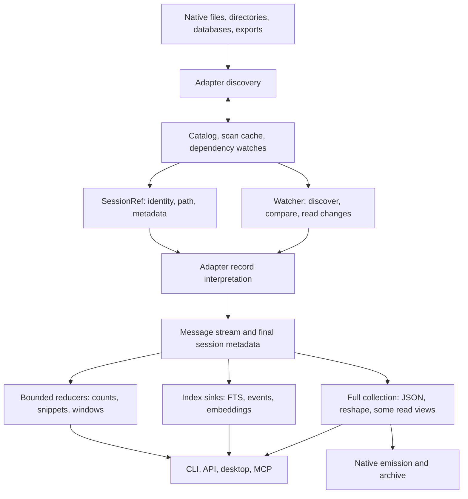

# Store datapaths: the system we are optimizing

The design core of the 2026-10-12..14 datapaths pass. The dated work log, per-batch evidence and
completion reports that used to follow live in git history (`git log -- docs/design/DATAPATHS.md`).
Budgets and measured numbers are in [`PERF.md`](PERF.md). Paths below are relative to `crates/`.

## What cv does

cv discovers sessions in heterogeneous stores, interprets their native histories into a common
message IR, and serves several different products from that IR: transcript reading, structured
facts, full-text/semantic search, live following, archives, datasets, and native session reshaping.
The task log is a separate event-sourced coordination store. Native CLI, HTTP, desktop and MCP
share much, but not all, of their read implementation. Browser upload is a separate, owned-memory
ingestion path for Claude, Codex and Gemini.

The key distinction is **source traversal, interpretation, payload decoding, retention, and
output**. Calling a method `stream` bounds none of those automatically. A reader can retain the
whole source before its first callback; a sink can collect everything; a bounded output chunker
can decode a whole field first. Each bound must hold across the composed path.

By default, a full read certifies computed counts and affordances into the catalog so later
listings need not recompute. **Read commands leave harness transcripts untouched but may write
derived cv state:** `cv events` refreshes stale events and counts in `catalog.db` before returning
rows (`cv events --help`). Global `--frozen` (or `CV_FROZEN=1`), resolved once by `cv_core::env::frozen()`, records
nothing: stale events stream directly, `cv ls` keeps the dash for an unknown count, and the
catalog (including skipped sources), scan cache and usage cache are not written. Commands
whose purpose is writing stores or sessions (`index`, hook installation/removal, reshaping,
`task`, archive sync/watch and config updates) exit 2. Explicit export output is still allowed.

## Existing foundations to retain

- Discovery already parallelizes adapters and many per-file scans (`cv-core/src/lib.rs`).
  Warm ordinary listings use the catalog and scoped freshness probes; they need no body parse.
- The common API is `Adapter::stream` plus `MessageSink`. `parse` is collection over that API.
  `Demand { tier, spans, offsets }` selects extras/carriers, lazy text and offsets.
- Claude/Codex have lazy source spans and resumable stream state. Codex has a useful direct path
  for giant tool outputs; most unchanged index jobs are skipped.
- FTS combines text, event and affordance extraction in one pass and one writer, streams body
  docs through a bounded channel, publishes resume marks (chunk boundaries; each read's end, with
  its open docs) after commit, and admits at most 2 GiB of estimated **source file bytes**.
- OpenCode, Goose and Hermes use per-session row iteration and the stores' existing indexes.
  Fixture query plans also support Devin's chain lookups and OpenClaw's event sequence query.
  Do not replace these with speculative PRAGMA tuning.
- Text `show --last N` already uses one lazy pass and a bounded deque. API message pages are
  lazy windows; event queries and `has:` counts have useful catalog fast paths.

## Reader inventory

This describes implementation, not a blanket performance claim. Required navigation state and
demanded output are not themselves avoidable bloat. Shared under every row since 0.17: one line
reader (`store::jsonl::Read`, mapped or positioned, driven by `jsonl::drive` for transcripts; mapped windows start at 8 MiB and
grow to hold a longer line), one validator
(`store::json::validate_value`), one string-body codec, one checked span resolver (`lazy`), one
JSON-whitespace trim rule, and one SQLite cell reader (`store::sqlite::Cells`).

| Store / format | Current traversal and retained state | Remaining costs / limits |
|---|---|---|
| Claude JSONL | One record codec (`claude/record.rs`, see [`CODEC.md`](CODEC.md)) over the shared JSONL reader in both builds; lazy text/arguments, facts, usage, discovery and fork heads are demands on it; checkpoints | Complete-mode carriers and metadata, rich `toolUseResult` sidecars and array tool results under 64 KiB remain owned |
| Codex JSONL | one record codec over `jsonl::drive` (mapped or positioned); bounded authority prepass; demand picks spans/inline/heads, never the decoder | Full/unknown metadata remains owned; discovery folds every record once, then resumes from its checkpoint |
| Codex legacy JSON / zstd | Legacy documents feed the same codec item by item; compressed modern JSONL decodes once per read into one arena read by the same line source; `cv index` reads discovery's arena, within a 2 GiB decoded window | Demanded rich fallback fields; decoded/staged disk extent; no general compressed incremental marks |
| Gemini legacy JSON | Checked selected string/canonical/composite results and formatted thoughts; native mmap or portable range projections | Full/complete modes and rich display extras still own required payloads |
| Gemini JSONL | Native mmap and portable checked-range replay retain compact order/keys; selected composite bodies use one session arena | Must scan complete history for replacements/rewinds; required metadata and rich display extras remain owned |
| Qwen modern JSONL | Checked selected reading, discovery, complete preparation, export and verification; finalized-record checkpoints | Requested title/metadata ownership; full replay systemPayload bookkeeping remains owned; no local fleet coverage |
| Kimi | Checked context bodies and cold discovery share positioned rotation handling; pending usage and wire enrichment preserved | Rotated fingerprint/navigation state and mutable trailing usage; requested metadata remains owned |
| Kimi Code | Selected cold wire/state discovery and checked finalized-step/complete playback; raw envelopes retain shared checked backing | Call/step state, requested title/cwd, unknown complete carriers and output backing extent |
| Grok | Checked selected reading, complete preparation/export/verification; mapped and positioned discovery/status projection | Header/system metadata remains owned; enrichment can revise old messages; portable rewind/hook framing now shares the metadata reader |
| Cline/Roo legacy | Shared selected-record source views, lazy text/arguments and bounded workspace extraction | Rich metadata, encoded arguments and selected composite output remain |
| Cline SDK | Shared source views, raw records and Anthropic block dispatch; large arguments use Json ranges | Selected rich fields and compatibility edge cases; giant full-output parity remains separate |
| Continue | Native/positioned typed header and selected-record source views; lazy payloads, checked encoded arguments and tool-answer dedup | Joined selected text, answer-ID state, rich metadata and mutable snapshots remain |
| OpenCode files | Ordered message descriptors, selected headers/parts and shared payload arena; deduplicated source inventory released before publication | Necessary file inventory grows with part count; native and portable late-query miss gates now pass |
| OpenCode SQLite | Indexed selected parts and checked complete native records; guarded DB/WAL/journal dependencies and faithful native replay | Encoded input validation/spill costs; demanded metadata; exports do not clone external linked child/shell stores; native SQLite and demanded output costs remain |
| Cursor SQLite | CLI/ACP reachable-message replay and IDE composer projections; selected strings, Lexical rich text and structured results share private backing | Encoded rich-text CPU cost, owned identifiers/full metadata, WITHOUT ROWID fallback |
| Devin SQLite | Compact forest, incremental checked message/metadata cells, reused compaction backing and bounded history-path inspection | Native SQL evaluation; navigation descriptors; prefix prompts/demanded rich extras; non-rowid owned fallback |
| Hermes SQLite | Indexed rows and private generation membership with exact collision checks; bounded replay suppression, transactional exports and checked complete bodies | Ordinary lean reads still own bodies/extras. Giant output rows/FTS allocate natively; prompt-only CPU tradeoff remains documented |
| Goose SQLite / legacy | Native indexed scalar family selection, shared checked SQLite lifecycle and framed legacy views; lean demand avoids unrelated sidecars | Full demanded metadata and explicit owned output remain; decoding/staging costs differ by shape |
| OpenClaw JSONL / SQLite | Checked branch replay; repeated parent queries promote to private ordered membership, first query stays native; incremental cells and compressed staging | O(events) navigation/backing; codec workspace; demanded complete/control/system metadata; native-cell and non-rowid fallbacks |
| Zed SQLite | Incremental blobs decoded once; lazy messages use checked selected text/arguments and skip discarded attachment bodies | Discovery defers counts but validates the whole decoded cell for snapshot cwd; Serde string scratch, decoded spill, requested metadata and WITHOUT ROWID native-cell fallback remain |
| LM Studio | Schema-selected document/turn views, selected lazy text spans and incremental variants; mapped or positioned sources | Bounded discovery title prefixes; Harmony decoding and arbitrary demanded output/metadata remain owned |
| ChatGPT / Claude account exports | Bounded metadata cache, shared ordered ID positions and positioned source views; selected-conversation replay | Branch descriptors, joined text and selected owned output; sender/empty-archive corrections have focused source oracles |
| OpenSession | Shared source validation/views and per-message IR projection | Selected authoritative rich fields remain owned; giant serialization proof separate from count/discovery |

Registry: `cv-core/src/harness/mod.rs`; implementations under `cv-core/src/harness/`.
Directory entry sizes and whole database sizes are **not** per-session transcript byte counts.
Compressed, encoded, scanned, decoded and emitted bytes must be labeled separately.

## Consumer inventory

| Operation | Actual work | Optimization boundary |
|---|---|---|
| Warm ls/stats | Catalog probe, metadata rows, sort/filter; query presence shares its source Probe, JSON rendering rechecks metadata in bounded batches | Preserve freshness between phases; measure discovery separately |
| Full discovery | Metadata projection, certified count reuse and cache/catalog publication; Codex, Grok, Kimi, Kimi Code, Hermes, Goose, Zed and OpenCode defer cold counts, Claude counts from its record heads | Remaining count-only adapter scans must go; exact fallback metadata and validation may still require EOF |
| Text windows / last N | Lazy range or deque, selected messages materialized | Already useful bounds; giant selected output is still output-sized |
| JSON show / MCP show | CLI show/export stages resolved frames and envelopes in bounded spill storage; EOF metadata retained. MCP stages selected windows | CLI Last retains lazy tail descriptors; owned adapter extras and redaction trees remain; MCP client payload size and subprocess startup |
| Affordance view | Facts projection into classified rows; checked bounded text summaries | Unprojected adapters retain rich extras; side stores and result rows; escaped validation still traverses the whole field |
| Doctor | Facts projection; checked text lengths and JSON writer counts | Attribution state, unsupported adapter rich/fallback parsing and demanded structured arguments |
| Query text predicate | Exact index-only matching IDs; cheap tri-state evaluation before parse | Mixed predicates still parse when cheap facts cannot decide |
| Other rich predicates | Predicate-sized streamed tool/model facts and shared source probes | Distinct unresolved relative paths retained until final cwd; compaction uses its existing separate boundary |
| FTS | Chunked text, bounded event spool and byte-capacity permits held through Tantivy document consumption; counts/checkpoints and one catalog connection per sweep. A query adds the stale suffix, read live from each mark into a temporary on-disk index | Writer arenas coexist with admitted documents; the live suffix's index is on disk, its heap one writer arena |
| Semantic indexing | Shares discovery inventory; source/model identity enables unchanged-vector reuse and deferred model load; atomic streamed save | Requested vector-store storage grows with session count; ranking candidate retention is now limited by requested result count |
| API pagination / HTTP windows | Verified page checkpoints and head metadata cache; selected HTTP JSON stages bounded frames through shared window selection | Window JSON parsing, demanded metadata and individual visible-message payloads remain; complete downloads use staged native writers |
| Watch | Verified checkpoints and bounded EOF metadata reused across tail polls | Strict source identity and dependencies; replay-only formats retain fallback parsing |
| Archive | Verified suffix read; bounded message spool and guarded canonical prefix copy; checked streaming payload output | Complete replacement artifact still writes O(output bytes); metadata width remains owned |
| Dataset | Streamed selection and bounded output staging; late predicates retain source descriptors in private spools | Bounded slice decoding reduces matched-query spool CPU; demanded owned producer fields remain |
| Pack/tools/token stats | Tool histograms fold per-message event scratch; pack excerpts use a ring; ordered usage rows reuse a bounded dependency-validated cache | Cold ledger publication, exact dedup I/O and model roster growth; tiny native sources bypass caching |
| Reshape/emit | Bounded shared JSONL stage; native Codex and Claude ports retain checked lazy bodies; verification reduces compact facts | Message roster/selected metadata, same-harness complete carriers and other emitters/materializing thinking transforms |
| Distill/findings | Shared analysis demand and one prepared tail; findings omit unused products and resolve text per message; --upto loads selected messages; borrowed sidecars use bounded staging | Ordinary CLI loads retain checked sources; analysis owns demanded products per message. Requested tails, notes, argument/result fallbacks, rich extras and prose remain output-sized; staged sidecar bytes scale with output |
| Prune/revive | Compact selection facts and source positions; checked Thinking, ASCII declassification, usage and linked-input projections; transcript/sidecar staging | Selected Unicode fields and oversized metadata retain owned fallbacks; validation and output staging remain required work |
| MCP observe | Retained-message watch callbacks and checked capped searchable prefixes | Other full producer modes, owned metadata and uncapped MCP show windows remain separate |
| Task coordination | Replay full append-only task log under CAS for writes | Separate workload; snapshot/tail only if measured task volume warrants it |

Key sources: `cv/src/cmd/view.rs`, `cv-core/src/{api,affordance,watch,lazy,stream}.rs`,
`cv-search/src/{fts,semantic}.rs`, `cv/src/cmd/{query,archive,pack,compose}.rs`.

## The counting rule

A listing reports what the metadata read already produced and nothing it would have to read more
for. A JSONL adapter whose discovery walks every record head anyway (Claude, and the adapters that
read every turn: Cursor, Cline, Devin, Gemini, LM Studio, OpenClaw, OpenSession, the exports)
counts for free and reports `Some(n)`, so `Some(0)` is a session with no turns. It counts by its
parser's own turn rule ([`Message::is_turn`]: a typed prompt or a reply), read from the same head:
a user record carrying only tool results, injected context or a sub-agent's return is no turn. An
adapter for which counting means decoding message bodies, opening a second store or reading files
the listing does not need (Codex, Grok, Kimi, Kimi Code, Qwen, Zed, Hermes, Goose, Continue,
OpenCode, whose turn kinds rest on parts, a Cursor composer with external bubble cells) reports `None`, "not counted", until a full read or `cv
index` certifies the number; a complete (round-trip) read, which carries rewound and superseded
rows, never certifies. The catalog keeps a certified count across metadata refreshes that leave
the source unchanged and drops it when the source changes. `--json` emits `null`, the table a
dash, `--sort-by messages` ranks uncounted sessions last, `cv stats` reports "N not counted yet".
The contract is the doc comment on `SessionRef::message_count`, held over every corpus session by
`every_listed_count_is_the_full_read_turn_count`; a count is never a proxy or an extrapolation.

## Correctness boundaries before reuse

1. Physical append does not imply logical append. Gemini replacement/rewind and OpenClaw leaf
   changes can replace an old visible suffix; Kimi usage, Kimi Code unfinished steps and Grok
   reasoning can revise the last pending message. Checkpoint only finalized output/state.
2. Identity includes dependencies: SQLite WAL, directory children, side metadata, rotation
   manifests and sidecar output. Since 0.17 there is one identity, `source::FileId { len,
   mtime_ns, dev, ino, ctime_ns }`, stored by the catalog's watches, the scan cache, the archive
   and watch alike; a captured `.jsonl` admits growth by content (`FileId::admits`: same device
   and inode, at least as long, the sampled prefix unchanged), never by waiting. Each adapter
   declares its auxiliary inventory (`Adapter::dependencies`), and each consumer (counts, events,
   FTS, usage, the archive) stores one `source::Record<T> { version, baseline, payload }` per
   session, tagged `T::TAG`, written by `Record::encode` and decoded and admitted (`admit`) on
   load; counts live in their record. `source::VERSION` is the one stored-format version (the
   view, discovery interpretation and embedding store share it): a bump rereads every consumer once. Catalog DB watches include
   WAL appearance, modification and disappearance. SQL output and stamps publish atomically; FTS
   invalidates its old baseline before changes and publishes a revalidated one after commit.
   Operation-local probes share file stats. Consumers capture conditional Claude fork siblings and
   resolved external output paths before reading them, including absent files. Complete read sets
   survive prefix checkpoints and are revalidated at publication.
3. Current resume marks sample the first 4 KiB and the 4 KiB preceding the mark. This is not a
   proof that the entire prefix is unchanged. FTS now requires growth before using a mark, so
   same-size rewrites take a whole pass; inode replacement also rejects reuse. A rewrite followed by
   growth can still escape the samples, and so can a same-length edit outside them: a captured
   `.jsonl` admits a changed stat (a writer mid-`write`) by the same samples, never by waiting.
   Unix unchanged reuse now additionally checks inode/ctime,
   rejecting same-size restored-mtime rewrites; platforms without that identity retain length/mtime guards.
   Unconditional detection of arbitrary prefix edits requires reading that prefix or a trusted
   writer/filesystem change signal; do not promise both zero prefix reads and such detection.
4. Lazy/full equivalence must compare **resolved content** and metadata. The stream dump
   serializes lazy text resolved (checked source text), so only a wire-form `Span` is a descriptor.
5. Existing format bugs must be isolated and tested as correctness changes. Fixed separately:
   Codex's giant-output shortcut dropped metadata preserved by its ordinary branch; Gemini's native
   wrapper omitted metadata fields and rejected escaped borrowed strings.
6. Exact final metadata can require EOF, even when a window needs only early messages. Separate
   payload retention from metadata traversal rather than silently returning incomplete metadata.

## Engineering direction

Optimize the composition, in this order:

1. **Consumer demand:** stop collecting payloads that a view discards; separate index matches from
   snippet generation. Use existing sinks and APIs rather than another command family.
2. **Payload lifetime:** genuinely bounded decoding for escaped spans, typed borrowed hot records,
   metadata-only discovery, raw source ranges for replay bodies. Preserve full/complete modes.
3. **Source/dependency identity:** consolidate invalidation and make format-specific stable append
   boundaries explicit before adding more resume implementations.
4. **Repeated work:** share passes, archive references, parsed metadata and verified positions where
   lifetime/invalidation makes reuse sound. Do not create a new persistent index without evidence.
5. **Concurrency:** once per-operation working sets are known, charge actual conservative working
   cost; bound in-flight payloads and writer queues. Parallelize independent work without multiplying
   unbounded allocations. File-backed resident pages and private heap need different interpretation.

No promised multiplier applies to every path. Exact first-run counts over an unindexed fleet
require reading their records unless the harness supplies authoritative metadata. Defer those
counts instead of treating a latency target as evidence that the reads can be skipped.

## Measurement method

Every change needs a narrow behavioral counterexample or measured cost, followed by composed-path
verification: direct adapter discard/count, discovery, derived views, windows, full output,
incremental index/watch, and writer costs, over tiny records, giant escaped/unescaped text, tool
arguments, many records, replay controls and database WAL changes.

Record instructions, decoded or traversed bytes, messages, allocation requests, peak live
allocations and staged bytes. Keep output hashing outside measured work. Wall/CPU, RSS and macOS
footprint observations explain investigations; they do not override work counting. Use
explicit-root adapters and frozen scratch sources; never mutate the real stores. Cold/warm
identifies application state, not a claim that the OS page cache was evicted.

## Open gaps and landed closures

Audited against `git log v0.17.0..HEAD` on 2026-10-21; a closure below names its commit.

- **Discovery demands, partly closed.** Claude's shared record heads (`576db8c1`), deferred
  Codex/Grok/Kimi/Kimi Code counts (`08a8dfb8`, `991c617e`, `efe87b52`, `ba6616ed`), metadata-only
  Hermes/Goose/Zed listings (`734af650`, `2ab873aa`, `80295ea7`), and Continue/OpenCode JSON-tree
  count deferral (`a200e811`, `d358ff0e`) landed. Certified-count reuse is `93faa442`.
  Qwen discovery reads facts only once presence and the first prompt are known (K1). **Open:**
  Cursor CLI counts to exclude empty stores. Removing these reads needs to preserve inclusion and exact metadata.
  Shared selections landed for OpenClaw/Hermes/Qwen tasks/Goose/exports (`62f0ccda`, `0a6a3b22`,
  `7475e978`, `20980e64`, `646b8fb6`); native allocations and validation still cost work.
- **Search freshness, closed.** Index plus a live read of its stale suffix from FTS marks, one
  BM25, all of it unless `--live-bytes`/`$CV_LIVE_BYTES`/config bounds it (`fts/live.rs`); a SQLite write rereads only moved `source::Rows`.
- **Archive inventory.** `archive sync` uses `index_all`'s references; `cv/src/cmd/archive` owns
  its checked artifact projection. An unavailable index falls back to discovery with a diagnostic.
- **Three message windowings, closed.** JSON, text rendering and pack relevance excerpts share
  `api::MessageWindow`; renderers retain their own byte accounting and metadata timing.
  CLI and HTTP search share `cv_search::Searcher::search`, including notes and snippets.
- **Format-dependent costs, open.** Grok sibling lineage keeps per-query metadata guards; Kimi wire
  enrichment and Kimi Code's index reread changed prefixes; Claude fork inference reads sibling
  heads (append-only dependencies). External SQLite schemas stay read-only; OpenClaw queries and
  giant native cells allocate in SQLite; Zed discovery grows Serde scratch; Hermes extras and
  row/FTS allocation stay owned. Rust heap gates do not bound those native costs.
- **Resume-mark sampling, a known limit.** Boundary 3 cannot detect every prefix rewrite plus
  growth, or every same-length edit during captured-read admission. No trusted change signal is
  available; whole-prefix hashing was measured and rejected (see `PERF.md`, Resume marks).
- **Fleet measurements, open.** First-run listing, full recount and repeated unchanged indexing
  still need a composed fleet measurement including compressed Codex. `6049df0a` keeps writer
  observations off discovery's work path; it does not remeasure the historical second-pass
  defect. The dated `PERF.md` results are not current performance promises.
